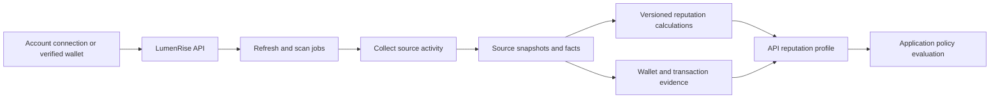

# LumenRise Reputation

**Explainable reputation built from connected accounts and observed activity.**

LumenRise brings participant identity, reputation, and token launch activity into one platform. This repository provides the evidence and scoring engine: it collects GitHub, X, and Stellar activity and turns those observations into inspectable reputation records.

The central idea is that a useful score needs context. LumenRise preserves the source data, signal contributions, collection time, and algorithm version behind its results, allowing applications to evaluate both a score and the quality of its evidence.

[Reputation model](#reputation-model) | [How it works](#how-it-works) | [Evidence quality](#evidence-quality) | [Getting started](#getting-started)

## Reputation model

LumenRise keeps development, social presence, and wallet activity as separate dimensions. The API assembles them into a participant profile while retaining their individual sources and validity.

| Dimension        | Source                          | Main signals                                                                                             |
| ---------------- | ------------------------------- | -------------------------------------------------------------------------------------------------------- |
| Developer        | GitHub                          | Account history, original repositories, stars, commits, pull requests, reviews, issues, and active years |
| Social           | X                               | Account age, followers, reported posts, and relationships with selected ecosystem accounts               |
| Stellar activity | Verified primary wallet history | Observed account operations and activity aggregates                                                      |

### Developer reputation

The developer model combines account history, original work, and contribution activity. Each available signal is normalized with diminishing returns and contributes according to its weight. This reduces the influence of very large counts while preserving contributions across different kinds of development activity.

Coverage is recorded during collection. When some data is unavailable, the resulting snapshot retains its partial status and the calculation uses the available signals. Consumers can distinguish a partial result from one based on complete collection.

### Social reputation

The social model combines two groups of evidence: profile metrics and relationships with a defined set of ecosystem accounts. Relationship signals distinguish following from being followed, with weights for account priority and ecosystem category.

Profile counts use diminishing returns, while relationship signals use a separate normalization model. The score retains the contribution of each signal so its composition remains visible. Collection reflects available provider data at the time of the requested refresh.

### Stellar activity and supporting evidence

Stellar scans collect available wallet history and build activity summaries. The API uses completed scan aggregates to calculate wallet activity reputation for the participant's verified primary wallet.

Payment facts and separate Soroban transaction lookups add evidence about observed wallet behavior. A diagnostic activity corroboration model compares available GitHub and Stellar signals when both sources are sufficiently complete and recent. It describes supporting activity evidence; it is not a unique-person proof or a Sybil verdict.

## How it works



1. **Connect:** The API links an external account or verifies a participant's wallet.
2. **Collect:** Workers process refresh requests, account scans, and transaction evidence jobs.
3. **Calculate:** GitHub and X snapshots produce developer and social scores. Wallet scan summaries supply the API's Stellar activity calculation.
4. **Explain:** Stored results retain their signals, contributions, source references, and versions.
5. **Apply:** The API checks connection state and freshness, presents the profile, and evaluates application-defined participation rules.

## Evidence quality

**Source traceability.** Reputation snapshots reference the account data used in the calculation. Signals carry their raw values, normalization, weights, and contributions, making results inspectable.

**Explicit completeness.** Collection and calculation states preserve partial, failed, and unavailable evidence. Missing inputs remain visible to the profile and policy layers.

**Connection and time context.** Results remain associated with their source account and collection time. The API excludes stale or disconnected-account scores from the current profile and applies policy-specific freshness requirements during evaluation.

**Versioned calculations.** Algorithm versions identify how each result was produced. Historical snapshots preserve the evidence behind earlier calculations within the configured retention period.

## Reliable background processing

Jobs are persisted in MongoDB, with RabbitMQ delivering work notifications. Workers also poll pending jobs, allowing processing to continue during broker interruptions. Retry handling and retention workers manage collection failures and stored history.

The local `/ready` endpoint reports database and broker state, queued and running work, failed jobs, and backlog indicators. This service supplies background processing; the public application interface belongs to the API.

## Platform architecture

| Repository                                                        | Responsibility                                                                          |
| ----------------------------------------------------------------- | --------------------------------------------------------------------------------------- |
| **[Reputation](https://github.com/poconik/lumenrise-reputation)** | Evidence collection, external account synchronization, and developer and social scoring |
| **[API](https://github.com/poconik/lumenrise-api)**               | Identity connections, wallet verification, reputation profiles, and policy evaluation   |
| **[Launch](https://github.com/poconik/lumenrise-launch)**         | Token launch discovery, contract state, and market indexing                             |

## Getting started

**Requirements:** Node.js 24+, npm, MongoDB, RabbitMQ, and access to the configured account and Stellar providers. Run the API migrations first; this service validates required indexes during startup.

```sh
npm ci
cp .env.example .env
```

Configure `.env` from [`.env.example`](.env.example). Match the API's database, broker, Stellar providers, OAuth credentials, and credential encryption key. The key must contain 64 hexadecimal characters. Keep `X_AUTO_SYNC_INTERVAL_HOURS=0` for the request-driven refresh flow.

```sh
npm run dev
```

Readiness is available locally at `http://127.0.0.1:5001/ready`. For production, run `npm run build` followed by `npm start`, supplying configuration through environment variables.

**Docker:** Start the API Compose stack and complete its migrations first. With matching database and broker credentials configured, run `docker compose up -d --build`. The worker joins the shared `lumenrise` network, and Compose checks readiness internally. See [compose.yml](compose.yml).

## Engineering

Built with **TypeScript and Node.js**, **MongoDB**, and **RabbitMQ**, with the **Stellar SDK** for blockchain access. Source collection integrates the **GitHub** and **X** APIs.

Run `npm run check` for TypeScript checks and `npm test` for worker and unit tests. `npm run check:model-parity` verifies shared model compatibility with the API. Integration testing commands are listed in [`package.json`](package.json).
